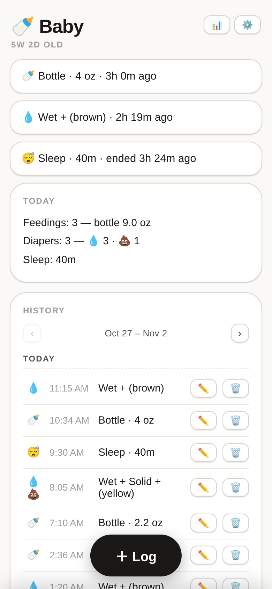
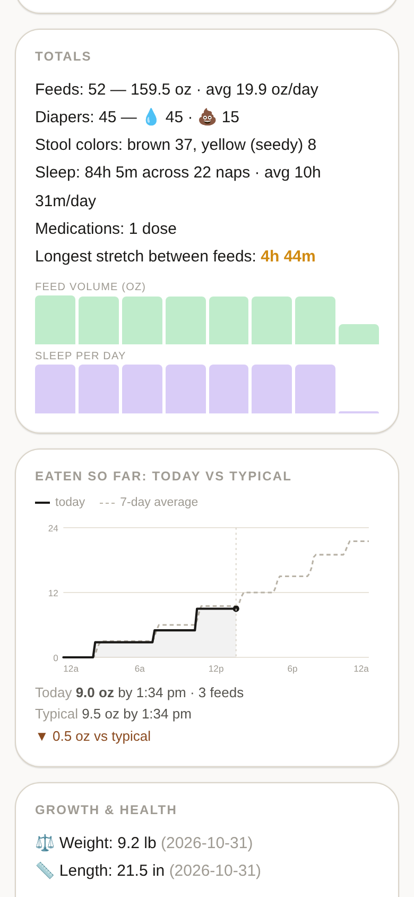

# Baby Log

A self-hosted newborn care tracker: bottles, diapers, sleep, tummy time, growth
measurements, medication doses and free-text notes — in one small FastAPI app
with a SQLite file behind it. Installs as a PWA, works offline-first on the
home screen, and never sends your baby's data anywhere.

Built for a household of tired people at 3am: two big tap targets, no accounts,
no sync, no subscription.



## Why another baby tracker

Phone-first trackers are SaaS products: accounts, ads, a subscription, and your
child's feeding history on someone else's server. This is ~3,500 lines in a
single file, one container, one SQLite file you can copy with `cp`. It was
written to track one baby and then generalised.

## Features

- **One-tap logging** — bottle (oz/ml), diaper (wet/solid + stool colour),
  sleep and tummy-time timers, growth measurements (weight lb+oz, length/head
  cm or in, temperature), medication, notes
- **Timers that survive** — start a nap, close the tab, come back hours later
  and the duration is still correct
- **"When" field** — backdate an entry you forgot to log (defaults to *now*,
  so a form left open never silently shifts the time)
- **Offline-first writes** — a tap is saved to `localStorage` and retried with
  a client-generated id, so a dead tailnet or a sleeping phone never loses an
  entry and a retry can't double-log it
- **Today card** — last feed / last diaper / current sleep at a glance
- **Pediatrician warning** — a pale or clay stool colour raises a banner, since
  that's the one colour that means "call the doctor"
- **7-day history with paging** — newest week first, ‹ › for older weeks
- **Reporting screen** — calendar *is* the date filter (tap a day, tap a second
  day for a range); per-day totals, longest stretch between feeds, sleep-trend
  calendar, weekly sleep timeline, growth + medication log, and per-device
  toggles for which cards you actually care about
- **"Eaten so far: today vs typical"** — cumulative intake by clock time, today
  against the average day in the selected range
- **Dose reminders** — log a medication with an interval (`Tylenol, 2.5 ml,
  every 6 h`) and get a Web Push notification 30 minutes before the next dose,
  with a 20-minute grace window if the host was asleep
- **CSV export + print stylesheet** — hand the pediatrician a clean sheet
- **Installable PWA** — manifest, maskable icon, standalone display, safe-area
  padding for notched phones
- **JSON API** — log from a script, a shortcut, or a chat assistant



## Quick start

```bash
git clone https://github.com/bentonsmith/babytracker.git baby-log && cd baby-log
docker compose up -d --build
open http://localhost:3001
```

First run creates `data/baby.db` and seeds default metadata. Set the baby's name
and birth date from the ⚙️ button in the app.

Without Docker:

```bash
python3 -m venv .venv && . .venv/bin/activate
pip install -r requirements.txt
DB_PATH=./data/baby.db uvicorn app:app --host 127.0.0.1 --port 8000
```

## Security model — read this before exposing it

**There is no authentication.** Anyone who can reach the port sees and can edit
everything. That is a deliberate design choice for a single-household app: the
network boundary is the auth.

- The container binds `127.0.0.1` only. Keep it that way.
- Reach it from your phone over a private network — Tailscale (what it was built
  for), WireGuard, or an SSH tunnel.
- Do **not** put it directly on the internet, and do not port-forward it.
- If you must reach it from outside a private network, put an authenticating
  reverse proxy (Caddy `basic_auth`, oauth2-proxy, Cloudflare Access) in front
  of it first.

The same caution applies to the JSON API: it is unauthenticated by design.

## Configuration

| Env var | Default | Meaning |
| --- | --- | --- |
| `DB_PATH` | `/data/baby.db` (container) | SQLite file location |
| `APP_UID` / `APP_GID` | `1000` / `1000` | owner the entrypoint gives the data dir, and the uid the app then runs as |
| `VAPID_SUB` | `https://example.com` | contact claim for Web Push — set it to a URL or `mailto:` you own |
| `BACKUP_VERBOSE` | unset | `1` prints a line per successful backup |

Port: container listens on `8000`; `docker-compose.yml` publishes it on
`127.0.0.1:3001` — change the host side if 3001 is taken.

The container starts as root only long enough to `mkdir`/`chown` the data
directory, then drops to `APP_UID`/`APP_GID` before starting uvicorn — so the
SQLite file and backups stay owned by a normal user, not root. Set those two to
your own `id -u`/`id -g`. If the DB ever ends up root-owned, backups fail with
*attempt to write a readonly database*.

## Backups

`scripts/backup_db.py` uses the SQLite backup API (safe while the app is
writing), writes a timestamped copy into `backups/`, and keeps the newest 30.

```bash
python3 scripts/backup_db.py            # silent on success
BACKUP_VERBOSE=1 python3 scripts/backup_db.py
```

Daily cron:

```cron
0 9 * * * cd /path/to/baby-log && python3 scripts/backup_db.py
```

A copy on the same disk is not a backup. Sync `backups/` somewhere else.

## Dose reminders (Web Push)

Log a medication with an interval — `{"name":"Tylenol","dose":"2.5 ml",
"interval_min":360}` — and the app notifies every registered device 30 minutes
before the next dose is due. Only the newest dose of each medication name
schedules a reminder, so logging the next one automatically reschedules it; a
dose logged without `interval_min` cancels it.

- Reminders are checked every 30 seconds in a background thread, and fire
  anywhere in `due − 30 min … due + 20 min`. The grace window is deliberate:
  a host that was suspended delivers late rather than never.
- VAPID keys are generated on first use and stored in the `meta` table (plus
  `<db dir>/.vapid-private.pem`, because `py_vapid` only reads PEM from a
  path). **Never delete them** — new keys silently invalidate every existing
  subscription.
- Set `VAPID_SUB` to a URL or `mailto:` you own. Apple rejects a `sub` claim it
  considers unreachable with `403 BadJwtToken`, which looks exactly like "push
  is broken".
- iOS needs 16.4+, the app **installed to the Home Screen** (Safari tabs can't
  receive push), and permission granted from a tap. The settings sheet does
  all three steps in one gesture.
- Push and PWA install need a secure origin. `tailscale serve` gives you HTTPS
  for free; plain HTTP on a LAN IP still logs fine but can't notify.

## API

All timestamps are UTC ISO-8601; the browser converts to local time.

| Method | Path | Purpose |
| --- | --- | --- |
| `POST` | `/api/events` | log an event (send `client_id` to make retries idempotent) |
| `GET` | `/api/events` | list — `?days=7` or `?start=&end=` (end exclusive), returns `has_more` |
| `GET` | `/api/events/{id}` | fetch one |
| `PATCH` | `/api/events/{id}` | edit |
| `POST` | `/api/events/{id}/stop` | stop a running timer |
| `DELETE` | `/api/events/{id}` | delete |
| `GET` | `/api/summary?hours=24` | rolling totals for the pediatrician |
| `GET` | `/api/report?days=30&tz=360` | per-day aggregates (or `?start=&end=`) |
| `GET` | `/api/export.csv?days=30` | CSV download |
| `GET`/`POST` | `/api/meta` | baby name, birth date |
| `GET` | `/api/push/key` | VAPID public key + registered device count |
| `POST` | `/api/push/subscribe` | register a device's push subscription |
| `POST` | `/api/push/test` | send one test notification to every device |
| `GET` | `/health` | `{"ok": true}` |

Event types: `feed`, `diaper`, `sleep`, `tummy`, `measurement`, `medication`,
`note`.

```bash
curl -s localhost:3001/api/events -H 'Content-Type: application/json' \
  -d '{"type":"feed","details":{"method":"bottle","amount":2.5,"unit":"oz"}}'

curl -s localhost:3001/api/events -H 'Content-Type: application/json' \
  -d '{"type":"diaper","details":{"wet":true,"color":"yellow"}}'
```

Only one timer of each kind can be open; starting a second closes the first at
the new start time.

## How it is built

- `app.py` — the whole app: FastAPI routes, schema init, and both pages (HTML +
  CSS + JS as module-level strings, no build step)
- `icons/icon.svg` — icon source; rendered to PNGs with `rsvg-convert`
- `scripts/backup_db.py` — backup helper
- `docker-compose.yml` — one service, loopback bind, optional `test` profile

Days are grouped by the *browser's* timezone: the client passes
`tz` (minutes from UTC) and the server shifts before bucketing. Night feeds
count toward the day they finished, which is what a pediatrician asks about.

### Staging copy

`docker-compose.yml` includes a second service on a `test` profile so you can
try changes against a copy of real data without touching the live app:

```bash
sqlite3 data/baby.db ".backup 'data-test/baby.db'"
docker compose --profile test up -d babytracker-test   # 127.0.0.1:3013
```

Compose builds one image per service — rebuild both after editing `app.py`:
`docker compose build babytracker babytracker-test`.

## Operating notes

- `docker compose up -d --build` to update; the DB survives rebuilds.
- The laptop sleeping is an outage. If this runs on a desktop-class machine at
  home, disable suspend or run it on something always-on.
- PWA install: iOS snapshots the icon and name at install time, so branding
  changes need *Remove from Home Screen* → re-add. Android picks manifest
  changes up on the next launch.
- See `DEPLOYMENT.md` for the fuller ops runbook.

### Demo data

`scripts/seed_demo.py` fills a throwaway database with eight days of plausible
entries — it is how the screenshots above were made, so no real household data
is in this repo:

```bash
mkdir -p data-demo
docker run -d --name bt-demo -u "$(id -u):$(id -g)" \
  -p 127.0.0.1:3014:8000 -e DB_PATH=/data/demo.db \
  -v "$PWD/data-demo:/data" baby-log
BASE=http://127.0.0.1:3014 python3 scripts/seed_demo.py
```

## License

MIT — see [LICENSE](LICENSE).
